# ForwardMesh

High-throughput file forwarding system that routes files through a chain of nodes using source-routed TCP packets with cut-through streaming and end-to-end CRC32 verification.

## Architecture

[](docs/architecture.svg)

> Full editorial page (with data-plane & Protocol V2 summary cards): [docs/architecture.html]([docs/architecture.html](https://fishman419.github.io/ForwardMesh/docs/architecture.html))

## Build & Test

```bash
# Build release binaries (bin/fwdd, bin/fwd)
make

# Run integration tests
make test

# Run AddressSanitizer tests
make asan-test

# Run macOS leaks(1) check
make leaks-check
```

## Run

**Server (`fwdd`):**
```text
./bin/fwdd [-p port] [-d dir] [-t threads] [-P pidfile] [-F] [-S] [-h]
  -p port     : specify port (default 40000)
  -d dir      : specify working directory (default .)
  -t threads  : number of worker threads (default 4)
  -P pidfile  : write process PID to pidfile
  -F          : run in foreground (do not daemonize)
  -S          : always cache relayed files on intermediate hops
  -h          : show this help
```

**Client (`fwd`):**
```text
./bin/fwd -a ip:port,... [options]
  -a addr : comma-separated list of ip:port forwarding chain
  -f file : file to send (push) or local output path (pull)
  -g file : remote relative file path to get (pull mode)
  -s      : cache file copies on intermediate hops (default: zero-disk streaming)
  -h      : show this help
```

## Examples

**Push (cut-through streaming vs. hop caching):**
```bash
# Multi-node cut-through stream (zero disk writes on Node1 & Node2):
./bin/fwd -a 127.0.0.1:40000,127.0.0.1:40001,127.0.0.1:40002 -f archive.tar.zst

# Multi-node push with single-pass tee caching on every hop (-s):
./bin/fwd -s -a 127.0.0.1:40000,127.0.0.1:40001,127.0.0.1:40002 -f archive.tar.zst
```

**Pull (get file from final node in chain):**
```bash
# Single node: client -> Node1 (relative to Node1's -d working directory)
./bin/fwd -a 127.0.0.1:40000 -g remote.txt -f local.txt

# Multi-node cut-through pull from Node3:
./bin/fwd -a 127.0.0.1:40000,127.0.0.1:40001,127.0.0.1:40002 -g remote.txt -f local.txt
```

## Protocol V2

All multi-byte header fields are encoded in big-endian (network byte order). Packet layout:
`ForwardHead (28B) + ForwardNode[ttl] (8B*ttl) + ForwardFile + data`

- `length` (`uint64_t`): 64-bit total packet size (supports >4 GB large files)
- `magic` (`uint32_t`): `0xFF44AADD`, `version` (`uint8_t`): `2`
- `cmd` (`uint8_t`): `ForwardPull (0)` or `ForwardPush (1)`
- `ttl` (`uint8_t`): remaining hops (max `32`)
- `flags` (`uint8_t`): `kFlagStoreOnHop (0x01)` enables intermediate tee-caching
- `id` (`uint64_t`): unique 64-bit request ID for cross-node log tracing
- `crc32` (`uint32_t`): IEEE 802.3 CRC32 verified on the fly at hops and endpoints

### Return Codes

- `ForwardSuccess (0)`
- `ForwardInterrupt (1)`
- `ForwardUnreachable (2)`
- `ForwardInternalError (3)`
- `ForwardInvalidRequest (4)`
- `ForwardFileNotFound (5)`
- `ForwardChecksumMismatch (6)`
